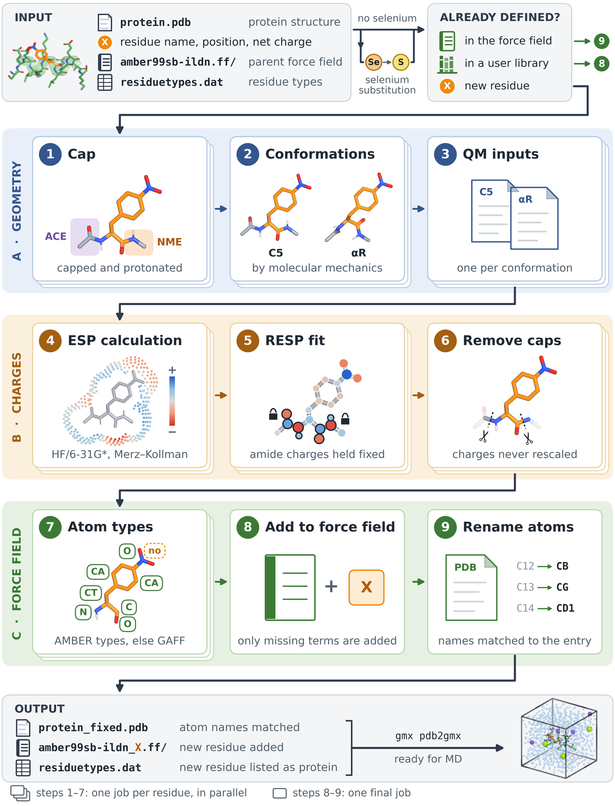

# NAA-Param

Automated parameterization of **non-canonical amino acids** (nAAs) and post-translationally
modified residues for molecular dynamics with **GROMACS** under the **AMBER** protein force
fields.

NAA-Param reproduces the protocol by which the charges of the AMBER protein force fields
were derived (Cieplak et al., 1995): a capped dipeptide in two backbone conformations, the
HF/6-31G\* electrostatic potential, and a two-stage RESP fit in which the peptide unit keeps
the charges shared by the canonical residues. It then integrates the new residue, in its
internal, N-terminal and C-terminal forms, into a copy of the parent force field that
`gmx pdb2gmx` reads directly.



## What it does

**Input**

- a protein structure (PDB) that contains the residue(s);
- for each residue: its three-letter name, its position in the chain (internal, N-terminal
  or C-terminal) and its net charge;
- the parent force field, as a GROMACS force-field directory (for example
  `amber99sb-ildn.ff`, with the `residuetypes.dat` that GROMACS ships beside it).

**What happens to each residue**

| Residue | What NAA-Param does |
|---|---|
| already defined in the parent force field | its atoms in the structure are renamed to match the force field (step 9 only) |
| defined in a library you imported | the published definition is adopted, with no quantum chemistry (from step 8) |
| new | it is derived in the nine steps below |

| # | Step | Programs | What it does |
|---|------|----------|--------------|
| 1 | `cap` | Open Babel | adds the ACE and NME caps and the hydrogens; the protonation follows the declared net charge |
| 2 | `opt` | AmberTools, OpenMM | builds the C5 and αR backbone conformations (four for a proline-like residue) and relaxes each by a restrained molecular-mechanics minimization |
| 3 | `extract` | | writes one quantum-chemical input per conformation, in a fixed atom order |
| 4 | `esp` | Gaussian 16 | HF/6-31G\* electrostatic potential on the Merz–Kollman points |
| 5 | `resp` | AmberTools | one two-stage RESP fit over all conformations; the peptide-unit atoms are held at the values of the residue's class in the parent force field, and a charged terminus is assembled by splicing |
| 6 | `merge` | | verifies every constraint and removes the caps; the charges are not rescaled |
| 7 | `acpype` | ACPYPE | GAFF atom types and bonded terms, with the fitted charges |
| 8 | `topology` | | adds the residue to a copy of the force field: AMBER atom types where they exist, bonded parameters from the parent force field, and only the missing ones from GAFF |
| 9 | `fixpdb` | | renames the atoms of the residue in the protein structure to match the new entry |

Steps 1–7 are independent for each residue and run in parallel; steps 8–9 run once, at the
end, because each residue extends the force field left by the previous one.

**Output**, in `<workspace>/naa_results/final_output/`:

| File | Content |
|---|---|
| `<parent>_<RES>.ff/` | the force field with the new residue; with several residues the name carries all of them, e.g. `amber99sb-ildn_LOH_SEP.ff` |
| `<protein>_fixed.pdb` | the structure, with atom names matched to the force field |
| `residuetypes.dat` | GROMACS's residue table, with the new residue listed as protein |

## Requirements

- **Python 3.10 or newer**, on Linux or macOS.
- **Gaussian 16** (`g16`, commercial licence) for the electrostatic potential.
  Psi4 and PsiRESP can be used instead; see [Without Gaussian](#without-gaussian).
- **AmberTools** on your `PATH`: `antechamber`, `parmchk2`, `tleap`, `espgen` and `resp`.
  AmberTools is not on PyPI; install it with conda (`conda install -c conda-forge ambertools`),
  from source, or load your cluster's module.
- **GROMACS** is not needed to run NAA-Param, but it is what the output is for, and the
  parent force field is usually taken from its installation (`share/gromacs/top/`).

The Python dependencies are installed by `pip`: ACPYPE, RDKit, Open Babel, OpenMM, ParmEd,
NetworkX, pydantic, Jinja2 and PyYAML.

## Installation

```bash
git clone <repository URL>
cd naa-param
python -m venv .venv && source .venv/bin/activate
pip install .

naa-param doctor        # reports every external program and Python dependency
```

This installs a single command, `naa-param`; everything is a subcommand of it.

| Command | Purpose |
|---------|---------|
| `naa-param setup` | Prepare a workspace for the residues of a protein (Slurm, PBS or local) |
| `naa-param submit` | Submit that workspace's jobs to the scheduler |
| `naa-param run-local` | Run the same workspace on this machine, without a scheduler |
| `naa-param status` | Report what a workspace has done so far |
| `naa-param run` | Run the nine steps for one residue from a config file |
| `naa-param check-ff` | Read a produced force field back and report anything inconsistent |
| `naa-param fixpdb` | Rename a residue's atoms in a PDB using a force field's `.rtp` |
| `naa-param add-profile` | Create a cluster profile (scheduler, account, queue, modules) |
| `naa-param import-library` | Import a force-field library you obtained (AMBER OFF/PREP, frcmod, GROMACS .itp) |
| `naa-param import-params` | Convert a published AMBER `frcmod` into a parameter set step 8 can use |
| `naa-param list-libraries` | List the imported libraries, and the published ones known as presets |
| `naa-param list-residues`, `list-params` | List the imported libraries that carry residues, or parameters |
| `naa-param calibrate` | Re-derive the peptide-unit charges of the canonical classes (optional) |
| `naa-param init-config` | Print a documented config template |
| `naa-param doctor` | Check the external programs and the Python dependencies |

`naa-param` alone lists the commands; `naa-param <command> --help` shows a command's options.

## Quick start

A protein with two new residues, LOH (neutral) and SEP (charge −1):

```bash
naa-param setup protein.pdb \
    --ncaas LOH SEP \
    --charges SEP:-1 \
    --ff /path/to/amber99sb-ildn.ff \
    --profile local \
    --workspace ./project

naa-param run-local ./project     # on this machine
naa-param status ./project        # what has run, at any time

naa-param check-ff ./project/naa_results/final_output/amber99sb-ildn_LOH_SEP.ff
```

`setup` checks the request against the structure and the force field before anything is
computed, and writes one job per residue. Residues not listed in `--charges` are neutral.
A run can be interrupted and repeated: a step whose output exists is skipped.

### On a cluster

The scheduler, account, queue, resources, module loads and environment activation come from
a **cluster profile**, a small YAML file, so the same command targets any cluster:

```bash
naa-param add-profile mysite --from pbs \
    --account PROJ01 --partition workq \
    --modules g16 amber \
    --venv "$HOME/naa-param/.venv"

naa-param setup protein.pdb --ncaas LOH SEP --charges SEP:-1 \
    --ff /path/to/amber99sb-ildn.ff --profile mysite --workspace ./project
naa-param submit ./project
```

Slurm and PBS are both supported. The shipped profiles (`cineca`, `leonardo`, `local`,
`pbs`) are templates: set your own account and the path of the environment in which
`naa-param` is installed, with `add-profile` or with `--account` and `--partition` on the
command line. A profile's `cpus` and `mem` also size the Gaussian jobs.

### Use the result with GROMACS

```bash
cd project/naa_results/final_output
GMXLIB=$PWD gmx pdb2gmx -f protein_fixed.pdb -ff amber99sb-ildn_LOH_SEP -water tip3p \
    -o conf.gro -p topol.top
```

Three details, each of which fails differently when missed:

- **`GMXLIB=$PWD` is required.** `pdb2gmx` reads `residuetypes.dat` from the library path,
  not from the force-field directory. Without it GROMACS uses its own copy and stops with
  *"there is no residue type for 'XXX'"*, although the force field is correct.
- **`-ff` takes the name without the `.ff` suffix.**
- **Use the `_fixed.pdb`, not the original structure:** the original still carries its own
  atom names.

## Residues at a chain end

A terminal residue has its own force-field entry, as in the AMBER force fields. Request it
with `--nter` or `--cter`, and give the charge of the terminal form under the name of its
entry (`N<RES>`, `C<RES>`):

```bash
naa-param setup protein.pdb \
    --ncaas SEP \                  # internal copies        -> [ SEP ]
    --cter SEP \                   # the one at a chain end -> [ CSEP ]
    --charges SEP:-1 CSEP:-2 \
    --ff /path/to/amber99sb-ildn.ff --workspace ./project
```

The charge of a `coo-` C-terminus is one below that of the internal residue, and that of an
`nh3+` N-terminus one above. `--nter-form nh2` and `--cter-form cooh` select the neutral
termini. `pdb2gmx` then picks the terminal entry from the position in the chain, while the
structure keeps the plain three-letter name.

## One residue at a time

`naa-param run` executes the nine steps for a single residue described by a config file:

```bash
naa-param init-config > LOH.yaml      # a documented template; fill in the paths
naa-param run --config LOH.yaml

naa-param run --list-steps                          # the nine steps, by number and name
naa-param run --config LOH.yaml --from-step resp    # resume from step 5
naa-param run --config LOH.yaml --from-step 8 --to-step 8 --force
```

For more than one residue use `naa-param setup`, which runs them in parallel and orders
only the part that has to be ordered.

## Special cases

- **Selenium and other elements GAFF cannot type** (`--mutate Se:S`). GAFF has atom types
  for H, C, N, O, S, P and the halogens only. On request, an element outside this set is
  replaced by its isovalent analogue, in the residue and in the protein structure, and the
  residue is then treated as that analogue. A selenomethionine becomes a methionine, which
  the parent force field already defines. Without the option, `setup` stops and says so.
  Do not use it when the element itself is the object of study.
- **A residue somebody already published.** No third-party library ships with this
  package. You obtain one, from its authors or from your own AmberTools, and import it with
  `naa-param import-library`; `setup` then adopts a residue when its name, net charge and
  heavy-atom connectivity match. `naa-param import-library phosaa10` imports the
  phosphorylated residues from your `$AMBERHOME`. See [`docs/licences.md`](docs/licences.md).
- **A published parameter set** (`--extra-params`). Step 8 takes each bonded parameter from
  the parent force field, then from a published set you supply, then from GAFF. A set is
  accepted only if its `[ defaults ]` match those of the force field.
- **A residue the force field already defines** is only renamed. To derive your own
  parameters for it instead, name it in `--reparameterize`.
- **ESP radii.** Gaussian has Merz–Kollman radii only for H, C, N, O, F, P, S, Cl, Br and I.
  Radii for B, Si, As, Se and Te are supplied automatically; any other is set with
  `esp_radii:` in the residue's config.

### Without Gaussian

With `esp_engine: psiresp` in the residue's config, Psi4 computes the HF/6-31G\* potential
and PsiRESP fits the charges, so that the whole protocol runs on open-source software. Both
run in their own environment, reached through one variable:

```bash
micromamba create -p /opt/psiresp-env -f naa_param/esp/psiresp-env.yml
export NAA_PARAM_PSIRESP_LAUNCHER="micromamba run -p /opt/psiresp-env"
```

AmberTools is still needed, for the geometries and the atom types; `g16`, `espgen` and
`resp` are not.

## Scope and limitations

- NAA-Param was developed and validated with **amber99sb-ildn**. Twelve canonical amino
  acids, presented to it as unknown residues, were re-derived and compared with the force
  field's own parameters, and simulated with both. Other AMBER-family force fields in
  GROMACS format have not been validated.
- The charge model is that of the parent force field: gas-phase HF/6-31G\* and atom-centred
  charges.
- Atom types and bonded parameters that the parent force field lacks come from GAFF. They
  are not refitted; side-chain torsions with no analogue in the parent force field may need
  to be refitted against quantum-mechanical data when rotamer populations matter.
- A residue is derived only if it is made of elements that GAFF can type.
- A side chain whose charge has no precedent among the canonical residues (for example a
  dianionic phosphate) has no class values for its peptide unit, which is then fitted with
  the rest of the residue.

## Documentation

[`docs/guide.md`](docs/guide.md) is the full user guide: every config field, chain termini,
cluster profiles, Slurm and PBS, running without a scheduler, recipes and troubleshooting.
[`docs/licences.md`](docs/licences.md) explains what the package does and does not ship,
and what to cite when you adopt published parameters.

## How to cite

A manuscript describing NAA-Param is in preparation; until it is published, please cite
this repository. Please also cite the methods on which the result rests:

- the charge-derivation protocol: Cieplak P, Cornell WD, Bayly C, Kollman PA.
  *J Comput Chem.* 1995;16:1357–1377;
- RESP: Bayly CI, Cieplak P, Cornell WD, Kollman PA. *J Phys Chem.* 1993;97:10269–10280;
- the parent force field you used, for example ff99SB-ILDN: Lindorff-Larsen K, et al.
  *Proteins.* 2010;78:1950–1958;
- GAFF, where a parameter came from it: Wang J, et al. *J Comput Chem.* 2004;25:1157–1174;
- ACPYPE: Sousa da Silva AW, Vranken WF. *BMC Res Notes.* 2012;5:367;
- every library you imported and adopted from (`naa-param list-libraries` prints its
  reference).

## Licence

The code is released under the MIT licence; see [`LICENSE`](LICENSE). It covers the code
only. No third-party force-field data is distributed with it; see [`NOTICE`](NOTICE).
